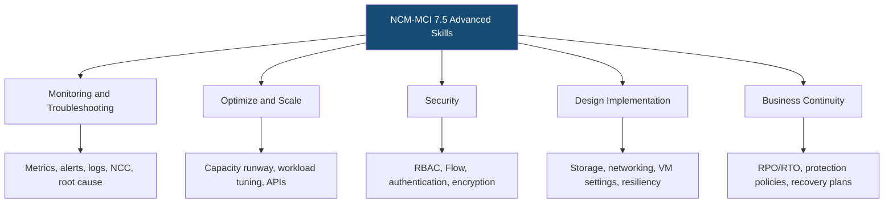
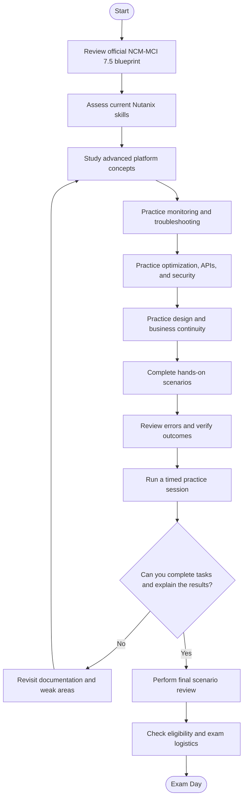
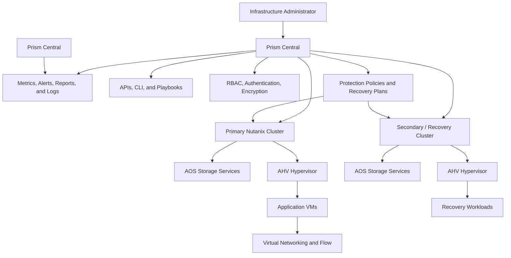
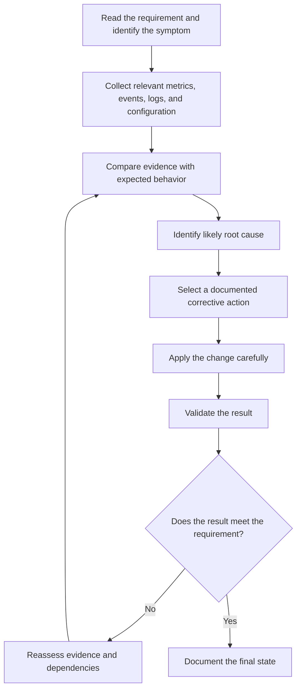
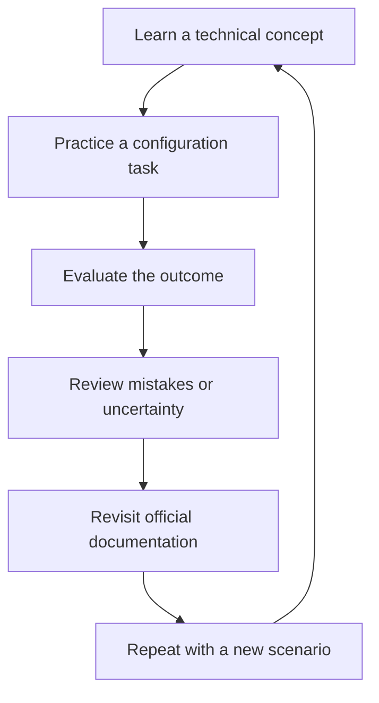
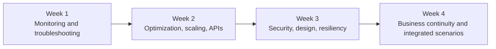

# Nutanix Certified Master – Multicloud Infrastructure (NCM-MCI 7.5) Study Guide

A hands-on preparation guide for the **Nutanix Certified Master – Multicloud Infrastructure (NCM-MCI) 7.5 certification**. This repository helps experienced infrastructure professionals organize their study around advanced Nutanix administration, performance troubleshooting, capacity optimization, automation, security, platform design, and disaster recovery.

Unlike a conventional multiple-choice exam, NCM-MCI 7.5 uses practical scenarios in a live Nutanix multi-cluster environment. Preparation should therefore go beyond learning product terminology: you need to interpret requirements, make configuration changes, use the appropriate tools, troubleshoot unexpected results, and verify that the final configuration meets the stated business need.

This guide combines the official exam blueprint with independent study recommendations, technical diagrams, practice scenarios, and a structured revision plan. Additional independent preparation material is available through [CertsGate](https://certsgate.com/exams/nutanix/ncm-mci).

> **Version and availability:** This guide targets NCM-MCI 7.5. Confirm the latest exam status, eligibility requirements, and scheduling options through Nutanix before registering.

---

## Table of Contents

- [About NCM-MCI 7.5](#about-ncm-mci-75)
- [Who Should Prepare?](#who-should-prepare)
- [Official Exam Details](#official-exam-details)
- [Five Official Knowledge Areas](#five-official-knowledge-areas)
- [Conceptual Skills Map](#conceptual-skills-map)
- [Exam Preparation Flowchart](#exam-preparation-flowchart)
- [Technical Environment and Architecture](#technical-environment-and-architecture)
- [Scenario Troubleshooting Workflow](#scenario-troubleshooting-workflow)
- [Circular Study Cycle](#circular-study-cycle)
- [Step-by-Step Preparation Strategy](#step-by-step-preparation-strategy)
- [Four-Week Study Roadmap](#four-week-study-roadmap)
- [Hands-On Practice Projects](#hands-on-practice-projects)
- [Original NCM-MCI Practice Scenarios](#original-ncm-mci-practice-scenarios)
- [Common Preparation Mistakes](#common-preparation-mistakes)
- [Readiness Checklist](#readiness-checklist)
- [Career Relevance](#career-relevance)
- [Frequently Asked Questions](#frequently-asked-questions)
- [Official and Additional Learning Resources](#official-and-additional-learning-resources)
- [About CertsGate](#about-certsgate)
  
---

## About NCM-MCI 7.5

The **Nutanix Certified Master – Multicloud Infrastructure (NCM-MCI)** certification validates advanced skills in analyzing, optimizing, troubleshooting, and securing the Nutanix Cloud Platform. It also evaluates whether a candidate can adapt infrastructure configuration to technical and business requirements.

The NCM-MCI 7.5 exam emphasizes practical administration rather than simply recalling definitions. Candidates work through scenarios involving cluster health, Prism analysis, storage and network configuration, security controls, automation, workload requirements, and business continuity.

For example, an infrastructure team might need to investigate high VM latency, plan additional cluster capacity, apply a security policy, automate a repetitive management task, or configure a recovery plan that satisfies application recovery objectives. The important skill is knowing how to approach the requirement, select the appropriate Nutanix feature, carry out the task, and verify the outcome.

The primary source for this study guide is the official [NCM-MCI 7.5 Exam Blueprint Guide (PDF)](https://www.nutanix.com/content/dam/nutanix/en/resources/datasheets/ds-ebg-ncm-mci.pdf).

## Who Should Prepare?

NCM-MCI 7.5 is intended for experienced infrastructure professionals who already understand Nutanix administration and need to demonstrate advanced operational skills.

Nutanix identifies the following typical background:

- Approximately **3–5 years of overall IT infrastructure experience**.
- Approximately **2–3 years of Nutanix virtualization experience**, or applicable training.
- Familiarity with Prism, AHV, AOS, infrastructure troubleshooting, and cluster administration.
- Practical knowledge of APIs and command-line tools.
- The ability to interpret business requirements and implement appropriate infrastructure configurations.
- Experience or training related to security policies and business continuity.

The exam may be relevant to senior infrastructure administrators, escalation engineers, experienced NOC/SOC operators, and Tier 2 or Tier 3 support professionals.

### Eligibility requirement

The official NCM-MCI 7.5 blueprint requires candidates to hold an **unexpired Nutanix Certified Professional (NCP) or Nutanix Certified Master (NCM) certification** to schedule the exam. Check your current certification status and the official eligibility rules before registering.

---

## Official Exam Details

The following information is taken from the official NCM-MCI 7.5 blueprint.

| Exam detail | Officially published information |
|---|---|
| Certification name | Nutanix Certified Master – Multicloud Infrastructure |
| Exam version | NCM-MCI 7.5 |
| Exam environment | Live Nutanix multi-cluster lab |
| Number of scenarios | 17 |
| Time limit | 180 minutes |
| Language | English |
| Passing score | 3000 on a scaled score range of 1000–6000 |
| Published price | US$300 per attempt |
| Delivery options | Remote proctoring or in-person at select test centers |
| Eligibility | An unexpired NCP or NCM certification |
| Certification validity | Three years after passing |

The exam uses a scaled scoring method. A score of 3000 should not be interpreted as a simple percentage of tasks completed correctly.

Because this is a live lab exam, prepare to work with the platform and supporting tools rather than relying on a traditional multiple-choice strategy. Review the [official blueprint](https://www.nutanix.com/content/dam/nutanix/en/resources/datasheets/ds-ebg-ncm-mci.pdf) for exam policies, task objectives, lab guidance, and referenced documentation.

---

## Five Official Knowledge Areas

The official NCM-MCI 7.5 blueprint organizes the tested skills into five sections. The descriptions below summarize the key study areas; use the blueprint for the full objective wording and references.

### 1. Monitoring and Troubleshooting

This section focuses on identifying problems, gathering evidence, interpreting metrics, and applying appropriate remediation.

Study how to:

- Use Prism analysis tools and performance graphs to identify anomalies.
- Correlate events with changes in metrics and entity behavior.
- Identify resource constraints using Prism Central.
- Collect system logs through Prism and CLI tools.
- Run appropriate Nutanix Cluster Check (NCC) checks.
- Interpret alerts and investigate root causes.
- Troubleshoot playbook errors.
- Create reports, custom views, and metrics.
- Configure alerts based on thresholds and monitoring requirements.

**Practical preparation:** Practice explaining why a metric matters, what evidence would support a diagnosis, and how you would confirm that a remediation worked.

### 2. Optimize and Scale

This section addresses resource planning, workload-specific configuration, and automation.

Key topics include:

- Using capacity runway scenarios to evaluate workload growth.
- Rightsizing a cluster for a new deployment.
- Planning future cluster expansion.
- Applying workload-specific best practices and technical notes.
- Selecting suitable VM and storage settings.
- Configuring relevant settings for end-user computing workloads.
- Applying appropriate SQL Server or other workload guidance when required.
- Using Nutanix APIs for create, read, update, and delete operations.
- Gathering and exporting information through APIs.
- Calling REST API endpoints from Playbooks.

**Practical preparation:** Work through scenarios where a requirement changes and you must determine which resources, settings, or automation steps should change in response.

### 3. Security

The security section covers advanced cluster configuration, network controls, authentication, log management, and encryption.

Review:

- Cluster hardening and security configuration.
- Security Configuration Management Automation (SCMA) and Advanced Intrusion Detection Environment (AIDE), where applicable.
- Role-based access control (RBAC).
- Cluster Lockdown Mode.
- Network segmentation.
- Flow Network Security policies.
- Remote Syslog configuration and troubleshooting.
- Authentication using supported methods such as Active Directory, SAML, or local authentication.
- Custom roles, permissions, service accounts, and certificates.
- Data-at-rest and data-in-transit encryption.
- Storage-policy-based encryption and Key Management Service (KMS) concepts.

**Practical preparation:** Given a security requirement, identify the control that addresses it, apply the configuration in a suitable environment, and verify that the intended behavior is achieved.

### 4. Design Implementation

This section tests the ability to translate requirements into workable Nutanix configurations.

Important areas include:

- Selecting storage settings and efficiency features for a workload.
- Understanding RF1 container use cases and constraints.
- Configuring Load-Balanced Volume Groups where appropriate.
- Designing VPCs, gateways, load balancers, floating IPs, and overlay networks.
- Extending subnets across availability zones where supported.
- Validating CVM and hypervisor VLAN configurations.
- Evaluating CVM resource configuration.
- Understanding CPU and memory oversubscription.
- Validating cluster high availability.
- Configuring resiliency, rebuild capacity reservation, and maintenance-related resiliency settings.
- Configuring advanced VM settings for demanding workloads.
- Evaluating storage and VM configurations for business-critical applications.

**Practical preparation:** Start with the business requirement, identify technical constraints, select a suitable configuration, and validate the result instead of applying a familiar setting automatically.

### 5. Business Continuity

This section focuses on protection policies, replication, recovery plans, and recovery validation.

Study how to:

- Configure protection policies based on recovery point objective (RPO) and recovery time objective (RTO).
- Troubleshoot protection policies and protection domains.
- Configure protection for multi-tier applications.
- Create recovery plans with appropriate sequencing.
- Configure network and IP mapping.
- Use custom scripts for application reconfiguration where required.
- Troubleshoot recovery-plan problems.
- Understand asynchronous, NearSync, synchronous replication, and AHV Metro-related scenarios covered by the blueprint.
- Execute and validate recovery workflows.

**Practical preparation:** Be ready to explain why a protection method meets the stated RPO/RTO, what its prerequisites are, and how you would verify recovery.

---

## Conceptual Skills Map

The following diagram is an independent study overview, **not an official exam-weighting chart**. The official blueprint identifies five objective sections, but this guide does not assign numerical percentages where a verified percentage breakdown is unavailable.

Use this map to organize your notes and track gaps. The official blueprint remains the authoritative reference for exam objectives.

---

## Exam Preparation Flowchart

NCM-MCI preparation should progress from objective review to technical study, hands-on practice, and repeated scenario validation. If you discover a gap, return to the relevant documentation and practice again.

This workflow is designed for a practical exam. It emphasizes performing and validating tasks, not just answering questions about them.

---

## Technical Environment and Architecture

The diagram below illustrates a conceptual Nutanix environment relevant to NCM-MCI preparation. It is a learning model, not a prescribed deployment design or a claim that every component must be present in every environment.

### Architecture concepts to understand

| Component or capability | Study focus |
|---|---|
| Prism Central | Centralized management, analysis, reporting, and supported automation workflows |
| AOS | Distributed storage, resiliency, storage efficiency, and workload storage requirements |
| AHV | VM configuration, resource allocation, high availability, and performance |
| Flow Network Security | Network segmentation and application security policy configuration |
| APIs and CLI | Administrative operations, information gathering, configuration, and troubleshooting |
| Monitoring tools | Performance graphs, metrics, events, alerts, and reports |
| Security controls | RBAC, authentication, certificates, Syslog, encryption, and hardening |
| Business continuity | Protection policies, replication, recovery plans, and validation |

Use the current Nutanix documentation to verify which management interface, API, CLI command, or configuration method applies to a particular task.

---

## Scenario Troubleshooting Workflow

A repeatable troubleshooting method is useful across performance, security, networking, storage, and recovery scenarios.

When practicing, make sure you can explain the difference between the observed symptom and the underlying cause. For example, high VM latency is a symptom; identifying the resource constraint or configuration issue requires evidence.

---

## Circular Study Cycle

Advanced preparation works best as a repeated cycle. Learn a feature, perform a task, evaluate the result, review mistakes, and repeat the exercise until the reasoning and workflow are clear.

This method is particularly valuable for APIs, Flow policies, capacity runway scenarios, advanced VM configuration, and recovery workflows. Knowing where a setting exists is not the same as understanding why a particular configuration is appropriate.

---

## Step-by-Step Preparation Strategy

### Step 1: Read the official blueprint carefully

Begin with the [NCM-MCI 7.5 Exam Blueprint Guide](https://www.nutanix.com/content/dam/nutanix/en/resources/datasheets/ds-ebg-ncm-mci.pdf).

Create a checklist for each of the five objective sections. The blueprint includes references to technical documentation, tools, and relevant tasks. Use those references to direct your study rather than relying on a generic virtualization course alone.

### Step 2: Assess your current technical ability

Identify which tasks you can already perform independently and which ones require documentation or assistance.

Pay special attention to areas that combine several skills, such as investigating performance issues, configuring a multi-tier application security policy, or troubleshooting a recovery plan.

### Step 3: Strengthen monitoring and troubleshooting skills

Practice interpreting metrics and events, collecting logs, running relevant NCC checks, and investigating alerts.

For every scenario, record:

- The symptom and affected component.
- The evidence you would collect.
- The likely causes.
- The corrective action.
- The method used to validate the result.

### Step 4: Practice optimization and automation

Review capacity runway analysis, workload best practices, cluster sizing, and expansion planning.

Then study Nutanix APIs, CRUD operations, information gathering, and Playbook integration. Practice understanding request parameters, the intended change, expected responses, and how to verify that an operation completed correctly.

### Step 5: Configure and verify security controls

Practice supported security settings in an authorized lab. Review role permissions, authentication, certificates, Syslog, encryption, cluster hardening, and Flow policies.

Use scenario requirements to decide which control is appropriate. After configuration, verify that the control behaves as expected and does not unintentionally block required communication or access.

### Step 6: Translate business requirements into technical configurations

Work through scenarios involving storage efficiency, VM resource settings, VPCs, gateways, load balancers, resiliency, and high availability.

Avoid memorizing a single configuration as universally correct. Consider workload requirements, available resources, fault tolerance, performance expectations, and documented platform constraints.

### Step 7: Practice business continuity

Review the relationship between RPO, RTO, replication, protection policies, recovery sequencing, network mapping, and post-recovery validation.

Practice diagnosing a failed recovery workflow and identifying which prerequisites or configuration settings need attention.

### Step 8: Perform complete practice scenarios

Do not practice only individual features. Combine tasks into realistic workflows: read the requirement, identify the correct component, make the change, and verify the final state.

Use a timer during some practice sessions, but prioritize accuracy and safe operation while learning.

### Step 9: Review every mistake

For each unsuccessful task, identify whether the issue was conceptual, procedural, a command/API error, a misunderstood requirement, or a missed validation step.

Revisit the matching official documentation and repeat the task using a new scenario.

### Step 10: Complete a readiness review

Before scheduling or sitting the exam, verify that you can independently complete representative tasks from all five objective areas and explain why the configuration satisfies the requirement.

---

## Four-Week Study Roadmap

This is an independent preparation schedule, not an official Nutanix timeline. Adapt it to your experience and access to a suitable lab.

| Week | Main focus | Recommended activities |
|---|---|---|
| 1 | Monitoring and troubleshooting | Practice performance analysis, alerts, logs, NCC, reports, and root-cause investigation |
| 2 | Optimization and automation | Study capacity runway, workload best practices, cluster scaling, APIs, and Playbooks |
| 3 | Security and design | Practice access controls, Flow policies, encryption, storage, networking, VM settings, and resiliency |
| 4 | Business continuity and revision | Practice protection policies, recovery plans, failover troubleshooting, and integrated timed scenarios |

A useful weekly routine is to combine official documentation, hands-on exercises, and a written review of mistakes. Keep a task log so you can distinguish tasks you completed independently from those you completed only by following a guide.

---

## Hands-On Practice Projects

The following are independent learning projects. They are not official exam labs, and they do not reproduce actual exam scenarios.

### Project 1: Performance investigation runbook

Create a fictional VM performance problem. Document the metrics, graphs, events, alerts, and logs you would inspect.

Your runbook should identify the possible root causes, the evidence needed to distinguish between them, and the steps you would use to validate a remediation.

### Project 2: Capacity planning exercise

Create a hypothetical cluster-growth requirement.

Document the current resource situation, projected workload needs, assumptions, and the questions you would investigate before recommending rightsizing or expansion. Use the appropriate Nutanix planning tools when available.

### Project 3: API automation workflow

Design an automation task that gathers information or manages a supported Nutanix resource through an API.

Document the intended operation, authentication requirements, request structure, expected result, error handling, and validation. Use a test environment and follow current API documentation.

### Project 4: Security configuration review

Create a checklist for a hypothetical application environment that requires role-based access, network segmentation, centralized log collection, and encryption.

Identify the relevant Nutanix controls and explain how you would validate the configuration. Keep the exercise aligned with supported product capabilities.

### Project 5: Workload design comparison

Compare two hypothetical workloads with different performance and resiliency requirements.

Document how storage configuration, VM resources, networking, high availability, and capacity planning might differ. Verify proposed settings against relevant Nutanix best-practice guides.

### Project 6: Business continuity runbook

Design a recovery plan for a hypothetical three-tier application.

Include:

- Application dependencies and recovery sequence.
- Required RPO and RTO.
- Protection and replication approach.
- Network and IP mapping.
- Any application reconfiguration steps.
- Validation checks after recovery.
- A troubleshooting path if recovery fails.

This project helps connect the business continuity objectives to practical configuration decisions.

---

## Original NCM-MCI Practice Scenarios

The following scenarios are original educational exercises created for this repository. They are **not official Nutanix exam tasks**, and they are not intended to reproduce the live exam.

Because NCM-MCI 7.5 is a hands-on lab exam, use these prompts to practice completing a workflow rather than merely selecting an answer.

### Scenario 1: Investigate a performance issue

**Situation:** An application team reports inconsistent VM performance. You have access to Prism monitoring information and relevant system logs.

**Your task:**
1. Identify which performance metrics and events you would inspect first.
2. Correlate the timeline of the reported issue with observed changes.
3. Determine what additional evidence is needed to isolate a likely cause.
4. Recommend and apply a documented corrective action in a suitable lab.
5. Verify whether the result addresses the original symptom.

**Review question:** Can you explain why the evidence supports your diagnosis rather than another possible cause?

### Scenario 2: Plan for workload growth

**Situation:** A team expects additional workloads and wants to understand whether the existing cluster can support the change.

**Your task:**
1. Identify the current capacity information and assumptions needed.
2. Use the available planning tools to assess the projected resource requirement.
3. Determine whether rightsizing, workload adjustment, or cluster expansion should be evaluated.
4. Document the trade-offs and validation steps.

**Review question:** Can you justify the recommendation using workload needs and available resource evidence?

### Scenario 3: Automate a management operation

**Situation:** An administrator wants to automate a repetitive information-gathering task across multiple Nutanix resources.

**Your task:**
1. Identify the relevant API endpoint and authentication method.
2. Determine the request parameters and expected response.
3. Handle errors or missing data.
4. Verify the returned information.
5. Explain how the task could be safely repeated.

**Review question:** Can you distinguish an API request that was submitted successfully from a result that was actually validated?

### Scenario 4: Implement an application security policy

**Situation:** A multi-tier application requires controlled communication between its components.

**Your task:**
1. Identify the intended communication paths.
2. Determine the appropriate Flow security policy approach.
3. Apply the configuration in a suitable test environment.
4. Verify expected communication and confirm that unrelated access has not been unintentionally permitted.

**Review question:** Can you explain how the policy satisfies the stated requirement?

### Scenario 5: Troubleshoot a recovery plan

**Situation:** A recovery workflow for a multi-tier application does not complete as expected.

**Your task:**
1. Review the protection configuration and recovery-plan sequence.
2. Check relevant replication status and prerequisites.
3. Inspect network and IP mapping.
4. Identify the failing step and apply an appropriate documented correction.
5. Validate the recovery workflow and the resulting workload state.

**Review question:** Can you demonstrate that the recovered environment meets the stated recovery requirements rather than merely showing that the workflow finished?

### How to evaluate your work

For each scenario, assess yourself on four points:

- **Requirement understanding:** Did you correctly interpret the task?
- **Technical execution:** Did you use the appropriate configuration method or tool?
- **Troubleshooting:** Could you diagnose errors without making unrelated changes?
- **Validation:** Did you verify the final state against the requirement?

Use the results to identify weak areas and repeat the corresponding exercises.

---

## Common Preparation Mistakes

### Treating a live lab like a multiple-choice exam

Knowing the definition of a feature is not enough. Practice locating the relevant setting or tool, performing the task, and verifying the result.

### Making changes before understanding the requirement

Read the scenario carefully and identify the requested outcome. Avoid modifying unrelated components or changing settings simply because they are familiar.

### Relying on memory instead of technical documentation

The blueprint references product documentation and practical tools. Learn how to find and interpret the relevant guidance rather than memorizing isolated commands.

### Ignoring APIs and CLI tools

NCM-MCI 7.5 includes automation and command-line-related objectives. Review API workflows, information gathering, and relevant CLI troubleshooting techniques.

### Overlooking security and business continuity

Do not focus exclusively on performance. Security controls, protection policies, recovery plans, and validation are core parts of the published objectives.

### Applying one configuration to every workload

Workload requirements differ. A suitable configuration depends on performance, capacity, availability, security, and application needs.

### Failing to validate a completed task

A configuration change is not proof that the requirement has been met. Check the resulting state, relevant metrics, policy behavior, or recovery outcome.

### Practicing only familiar tasks

Use a task log to identify which activities still require documentation or assistance. Allocate more revision time to weak areas rather than repeatedly performing only comfortable tasks.

---

## Readiness Checklist

Use this checklist to assess your practical preparation.

- [ ] I have read the official NCM-MCI 7.5 Exam Blueprint Guide.
- [ ] I understand the exam's live lab format and time limit.
- [ ] I can use Prism analysis tools to investigate performance issues.
- [ ] I can collect relevant logs and perform appropriate health checks.
- [ ] I can interpret alerts and investigate likely root causes.
- [ ] I can create or interpret reports, custom metrics, and monitoring alerts.
- [ ] I can evaluate capacity runway scenarios and workload growth.
- [ ] I understand workload-specific best practices and configuration requirements.
- [ ] I can use Nutanix APIs for appropriate management or information-gathering tasks.
- [ ] I understand relevant Playbook and automation workflows.
- [ ] I can configure and validate appropriate access controls and security settings.
- [ ] I understand Flow Network Security policies and network segmentation.
- [ ] I can investigate Syslog and certificate-related configuration issues.
- [ ] I understand encryption and KMS-related concepts covered by the blueprint.
- [ ] I can translate storage, networking, VM, and resiliency requirements into configurations.
- [ ] I can explain cluster capacity, high availability, and resiliency considerations.
- [ ] I understand protection policies, replication, RPO, and RTO.
- [ ] I can create and troubleshoot recovery plans and validate recovery workflows.
- [ ] I have practiced integrated scenarios, not just individual features.
- [ ] I can complete representative tasks without relying entirely on step-by-step instructions.
- [ ] I can explain why each configuration satisfies its requirement.
- [ ] I have checked my certification eligibility and current exam availability.

If several items remain unchecked, focus on those objectives before attempting to judge your readiness from practice scores alone.

---

## Career Relevance

NCM-MCI preparation is relevant to experienced professionals who manage and optimize Nutanix infrastructure in enterprise environments.

Related roles may include:

- Senior Nutanix infrastructure administrator.
- Virtualization or infrastructure engineer.
- Senior systems engineer.
- Infrastructure operations specialist.
- Technical escalation engineer.
- Cloud platform operations engineer.
- Disaster recovery or business continuity engineer.

The certification can provide evidence of advanced Nutanix platform skills, particularly in troubleshooting, configuration, optimization, security, and recovery. Career outcomes also depend on hands-on experience, communication skills, broader infrastructure knowledge, and employer requirements.

## Frequently Asked Questions

### What is the NCM-MCI 7.5 certification?

It is the Nutanix Certified Master – Multicloud Infrastructure certification. It validates advanced administrative skills in optimizing performance, troubleshooting, monitoring health, securing infrastructure, and aligning platform configuration with business requirements.

### Is NCM-MCI 7.5 a multiple-choice exam?

No. The official blueprint describes a live lab exam consisting of 17 scenarios performed in a Nutanix multi-cluster environment.

### How long is the NCM-MCI 7.5 exam?

The official blueprint lists a time limit of 180 minutes.

### What is the NCM-MCI 7.5 passing score?

The published passing score is 3000 on a scaled range from 1000 to 6000. This is not a direct percentage of tasks completed correctly.

### What experience is recommended?

Nutanix identifies a typical candidate as having approximately 3–5 years of overall IT infrastructure experience and 2–3 years of Nutanix virtualization experience, or applicable training.

### Is another Nutanix certification required?

Yes. The NCM-MCI 7.5 blueprint requires an unexpired NCP or NCM certification to be eligible to schedule the exam. Confirm the requirement against the latest official information.

### Which training course is recommended?

Nutanix recommends **Advanced Administration and Performance Management (AAPM)**. Review the [official training information](https://www.nutanix.com/support-services/training-certification/training) for current course details and availability.

### Are practice questions enough for NCM-MCI preparation?

Practice questions can help review concepts, but a hands-on lab exam requires practical execution. Combine the official blueprint, technical documentation, suitable lab work, and scenario-based troubleshooting. Independent resources such as CertsGate can supplement this process.

### Where can I find the official objectives?

Use the [NCM-MCI 7.5 Exam Blueprint Guide](https://www.nutanix.com/content/dam/nutanix/en/resources/datasheets/ds-ebg-ncm-mci.pdf). It includes the objective descriptions, technical references, training recommendations, and live lab considerations.

---

## Official and Additional Learning Resources

Start with Nutanix's own documentation and training. These resources provide the foundation for accurate preparation.

| Resource | How it helps |
|---|---|
| [NCM-MCI 7.5 Exam Blueprint Guide](https://www.nutanix.com/content/dam/nutanix/en/resources/datasheets/ds-ebg-ncm-mci.pdf) | Official exam details, objectives, technical references, and live lab guidance |
| [NCM-MCI certification page](https://www.nutanix.com/support-services/training-certification/certifications/certification-details-ncm-mci) | Certification overview, eligibility, exam information, and registration |
| [Nutanix training](https://www.nutanix.com/support-services/training-certification/training) | Official training information, including Advanced Administration and Performance Management |
| [Nutanix Documentation Portal](https://portal.nutanix.com/page/documents/list) | Product documentation, configuration instructions, and technical troubleshooting references |
| [Nutanix Developer Portal](https://www.nutanix.dev/) | API-related learning and developer resources |
| [Nutanix Test Drive](https://www.nutanix.com/test-drive) | Guided exploration of available Nutanix product experiences |
| [Nutanix Community](https://next.nutanix.com/) | Technical discussions and community learning |
| [CertsGate NCM-MCI preparation page](https://certsgate.com/exams/nutanix/ncm-mci) | Independent supplementary certification-preparation materials |

Some Nutanix technical documentation may require a support-portal account or appropriate access. Confirm that a reference applies to the software version and environment relevant to your task.

---

## About CertsGate

[CertsGate](https://certsgate.com/exams/nutanix/ncm-mci) is an independent IT certification preparation resource. Its relevant study guides and practice materials can complement official Nutanix documentation, training, and hands-on exercises.

For NCM-MCI preparation, supplementary questions and knowledge checks can help reinforce concepts related to performance analysis, infrastructure optimization, security, workload configuration, and business continuity. Review every uncertain answer, map the gap to an official objective, and return to the relevant technical documentation or lab exercise.

CertsGate is referenced here as an independent learning resource. This repository does not claim that CertsGate is an official Nutanix partner or that third-party practice material reproduces live exam scenarios.

